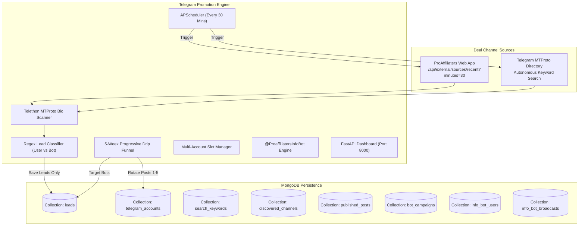

# Telegram Promotion Tool (ProAffiliaters Lead Engine) 🚀

> **Autonomous Lead Extraction, Bio-Scanning, MTProto Keyword Discovery & 5-Week Multi-Account Drip Campaign Engine**

[](https://fastapi.tiangolo.com)
[](https://python.org)
[](https://www.mongodb.com/)
[](https://github.com/LonamiWebs/Telethon)
[](https://opensource.org/licenses/MIT)

---

## 📌 Overview

**Telegram Promotion Tool** is an automated background lead extraction and promotion pipeline connected to the **ProAffiliaters Web Application** (`https://app.proaffiliaters.com`) and hosted on **`https://telegramtools.proaffiliaters.com`**.

It automatically discovers Telegram deal channels, scans their bios/descriptions using Telegram MTProto, extracts direct deal owner contacts (`@username`) and deal bots, stores them deduplicated in MongoDB, and executes a progressive 5-week drip forwarding campaign.

---

## ⚡ Key Features

1. **Autonomous Telegram Keyword Search**:
   - Searches Telegram's global directory every 30 minutes for high-converting deal keywords (`loot deals`, `amazon deals`, `coupons`, `affiliate deals`).
   - Automatically inspects matching channels, applies a 7-day anti-duplicate cooldown, and pulls new leads into MongoDB.
2. **External Deal Channel Polling**:
   - Polls `https://app.proaffiliaters.com/api/external/sources/recent?minutes=30` with API authentication.
   - Resolves invite links / usernames, scans descriptions, and classifies leads into `user` (human owners) vs `bot` (deal bots).
3. **Multi-Account Login & 5-Week Drip Funnel**:
   - Connects unlimited Telegram accounts into numbered slots (Slot 1 to 5+) with interactive phone/OTP/2FA login.
   - Features MTProto socket keepalive pinging and auto-rebind to guarantee seamless 2FA logins.
   - Rotates promotional posts across Accounts 1 to 5 with an enforced 7-day cooldown per stage.
4. **Official Info Bot (@ProaffiliatersInfoBot)**:
   - High-converting Telegram bot landing flow with attribution tags (`/start <campaign>`).
   - Admin Command Console (`/admin`) with live analytics and WYSIWYG rate-limited broadcast engine.
5. **Modern Single-Page Dashboard (Pure Light Mode)**:
   - Premium ProAffiliaters SaaS design with a fixed left navigation sidebar, KPI cards, real-time lead tables, keyword manager, account slot grid, and streaming activity logs.
6. **Built-in Authentication & Public Security Barrier**:
   - Cryptographic HMAC-SHA256 session tokens with 30-day HTTP-only cookies and automatic route-guarding for public URL hosting.
7. **Production VPS Automation (`deploy.sh`)**:
   - Single-command automated deployment script configuring Python venv, PM2 24/7 daemon management, Nginx reverse proxy with WebSocket/SSE support, and Let's Encrypt SSL via Certbot.

---

## 🛠️ Architecture



---

## 🚀 Quick Start (Local Development)

### 1. Prerequisites
- Python 3.10+
- MongoDB running locally on `localhost:27017` or MongoDB Atlas URI
- Telegram API Credentials (`TELEGRAM_API_ID` & `TELEGRAM_API_HASH` from [my.telegram.org](https://my.telegram.org))

### 2. Setup Environment
```bash
# Clone the repository
git clone https://github.com/hackerpushkar/telegram-automation-promotion-tool.git
cd telegram-automation-promotion-tool

# Create and activate virtual environment
python -m venv venv

# Windows (PowerShell):
.\venv\Scripts\Activate.ps1
# Linux / macOS:
source venv/bin/activate

# Install dependencies
pip install -r requirements.txt

# Copy environment template
cp .env.example .env
```

### 3. Launch Tool
```bash
python src/main.py
```
Open your browser at **`http://localhost:8000`** to access the dashboard.

---

## 🔐 Dashboard Authentication

When hosted on the public domain `https://telegramtools.proaffiliaters.com`, access to the dashboard is secured by a login barrier:

- **Admin Login Email**: `spushkar812@gmail.com`
- **Admin Password**: `Pushkar@9084`
- **Session Duration**: 30 Days (HTTP-only secure HMAC cookie)

---

## 🌐 Production VPS Deployment

Run the master deployment script on your Ubuntu/Debian VPS:

```bash
# Full automated deployment (venv + dependencies + PM2 + Nginx):
sudo ./deploy.sh

# Provision automated Let's Encrypt SSL:
sudo ./deploy.sh --setup-ssl

# Check status:
./deploy.sh --status

# Stream live PM2 logs:
./deploy.sh --logs
```

---

## 🧪 Automated Test Suite

Run the full automated test suite:

```bash
# 1. Test Authentication & 2FA MTProto Account Login:
python testing_files/test_auth_and_account_login.py

# 2. Test Multi-Account Manager & 5-Week Drip Funnel:
python testing_files/test_multi_account_drip.py

# 3. Test Autonomous Keyword Search:
python testing_files/test_keyword_search.py

# 4. Test Lead Extraction & Classification:
python testing_files/test_lead_extractor.py

# 5. Test Info Bot (@ProaffiliatersInfoBot):
python testing_files/test_info_bot.py

# 6. Test Channel Publisher & Bot Forwarder:
python testing_files/test_bot_forwarder.py
```

---

## 📂 Repository Map
- **[`src/`](file:///c:/Users/spush/OneDrive/Desktop/Proaffiliaters/Telegram%20Promotion%20Tool/src/)** - Core source packages (`account_manager.py`, `auth.py`, `drip_engine.py`, `keyword_search_engine.py`, `web.py`, etc.).
- **[`testing_files/`](file:///c:/Users/spush/OneDrive/Desktop/Proaffiliaters/Telegram%20Promotion%20Tool/testing_files/)** - Automated unit and integration test suites.
- **[`scripts/`](file:///c:/Users/spush/OneDrive/Desktop/Proaffiliaters/Telegram%20Promotion%20Tool/scripts/)** - Administrative CLI tools (account login, post publisher, channel diagnostics).
- **[`deploy.sh`](file:///c:/Users/spush/OneDrive/Desktop/Proaffiliaters/Telegram%20Promotion%20Tool/deploy.sh)** - Master VPS deployment script for `telegramtools.proaffiliaters.com`.
- **[`projectinfo.md`](file:///c:/Users/spush/OneDrive/Desktop/Proaffiliaters/Telegram%20Promotion%20Tool/projectinfo.md)** - Comprehensive architectural documentation, data schemas, and API specs.
- **[`setup.md`](file:///c:/Users/spush/OneDrive/Desktop/Proaffiliaters/Telegram%20Promotion%20Tool/setup.md)** - Step-by-step setup and operational guide.
- **[`implementation.md`](file:///c:/Users/spush/OneDrive/Desktop/Proaffiliaters/Telegram%20Promotion%20Tool/implementation.md)** - Feature roadmap and changelog tracker.

---

## 📄 License
This project is licensed under the MIT License.

