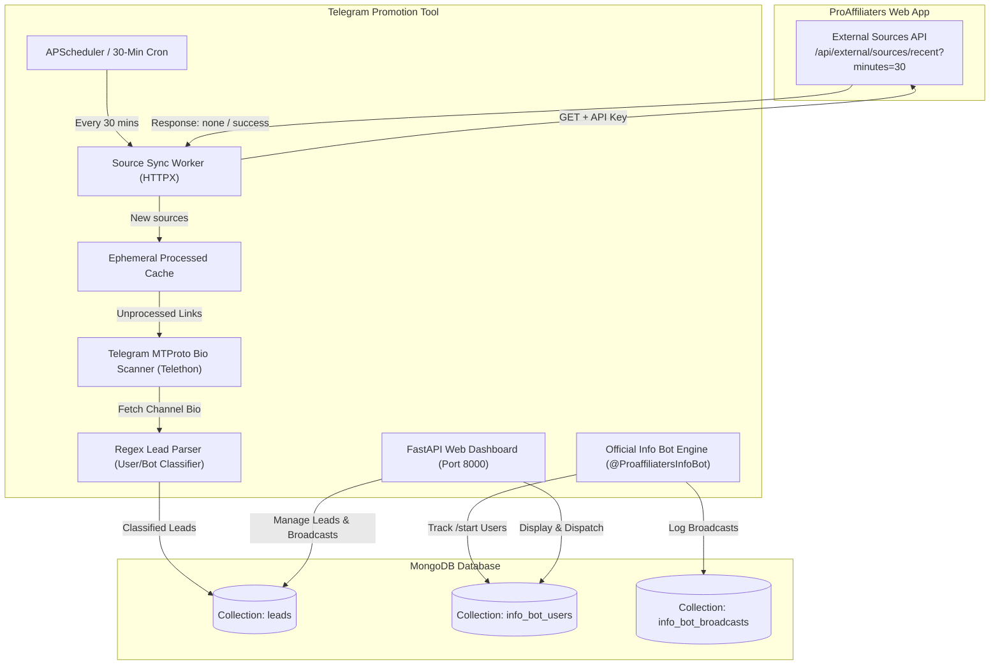

# projectinfo.md - Telegram Promotion Tool (ProAffiliaters Lead Engine)

## 1. Project Overview

**Telegram Promotion Tool** is an automated lead generation, Telegram channel bio-scanning, and customer engagement service designed to work in synergy with the **ProAffiliaters Web Application**.

### Dual Engine Capabilities:
1. **Source Channel Bio Scanner**:
   - Every 30 minutes, fetches newly registered source deal channels from the ProAffiliaters External API (`/api/external/sources/recent?minutes=30`).
   - Resolves channels via Telegram MTProto API, extracts channel bios/descriptions, parses direct owner/manager contacts and promotional bots, and stores deduplicated leads into MongoDB collection `leads`.
   - **Sources are not stored in MongoDB**; only extracted leads are persisted.
2. **Official Info & Ad Landing Bot (@ProaffiliatersInfoBot)**:
   - Central landing bot for creator acquisition and Telegram ad campaigns.
   - Captures user leads and attribution campaign tags (`/start <campaign_name>`) into collection `info_bot_users`.
   - Serves an interactive in-bot tour with inline buttons (Forwarder, AutoPilot, Deals, WordPress, Plans).
   - Provides an Admin Command Console (`/admin` / `admin_menu`, Admin ID: `7573032265`) with live analytics, user inspection, and a WYSIWYG broadcast engine with custom inline buttons.

---

## 2. Architecture & Data Flow



---

## 3. External API Specifications (ProAffiliaters Web Application)

- **Base Endpoint**: `https://app.proaffiliaters.com/api/external/sources/recent`
- **Method**: `GET`
- **Query Parameter**: `minutes=30`
- **Authentication Header**: `x-api-key: proaff_ext_source_sync_key_2026`
- **Alternative Fallback**: `?apiKey=proaff_ext_source_sync_key_2026`
- **Timeout**: 15 seconds

### Expected Responses

#### Case A: No new sources in the last 30 minutes
```json
{
  "status": "none",
  "count": 0,
  "sources": [],
  "message": "No new sources in the last 30 minutes",
  "windowMinutes": 30,
  "since": "2026-10-26T16:30:00.000Z",
  "serverTime": "2026-10-26T17:00:00.000Z"
}
```

#### Case B: New source channels found
```json
{
  "status": "success",
  "count": 1,
  "windowMinutes": 30,
  "since": "2026-10-26T16:30:00.000Z",
  "sources": [
    {
      "id": "6adf873eb0447db912685148",
      "name": "Deals Loot Channel",
      "platform": "telegram",
      "chatId": "-1009998887776",
      "inviteLink": "https://t.me/+AbCdEf_TestHash999",
      "active": true,
      "createdAt": "2026-10-26T16:55:00.000Z"
    }
  ],
  "serverTime": "2026-10-26T17:00:00.000Z"
}
```

---

## 4. Bio Scanning & Lead Extraction Logic

### Lead Types
1. **Human Contact (`user`)**:
   - Channel owner / admin usernames specified for promotions, paid deals, or contact (e.g. `@DealsOwner`, `t.me/admin_john`).
2. **Bot (`bot`)**:
   - Automated promotion bots or submission bots ending in `bot` or `_bot` (e.g. `@DealsPostBot`).

### Classification Rule:
```python
if username.lower().endswith("bot"):
    lead_type = "bot"
else:
    lead_type = "user"
```

---

## 5. Official Info Bot (@ProaffiliatersInfoBot) Architecture & Engine

Ported directly from the Web Application to run centrally within the Telegram Promotion Tool engine.

### Operational Responsibilities:
1. **Ad Landing & Attribution Capture**:
   - Creators clicking Telegram ads or affiliate promotion links land on `@ProaffiliatersInfoBot`.
   - The `/start <campaign_name>` parameter is extracted and saved into MongoDB collection `info_bot_users` as `start_payload`.
2. **Interactive Feature Showcase**:
   - In-place callback query message edits guide visitors through ProAffiliaters features:
     - ⚡ Auto Forwarder (`info_forwarder`)
     - 🚀 24/7 AutoPilot (`info_autopilot`)
     - 🔥 Trending Deals (`info_deals`)
     - 🌐 WordPress Auto-Publishing (`info_wordpress`)
     - 💎 Plans & Pricing (`info_pricing`)
     - 🎥 Step-by-Step Blueprint (`info_blueprint`)
     - Direct links to web dashboard, official channel, and 1-on-1 human support.
3. **Admin Command Console (`/admin` / `admin_menu`)**:
   - Strictly restricted to configured `TELEGRAM_INFO_BOT_ADMIN_ID` (`7573032265`).
   - Real-time lead count analytics, recent user inspection, broadcast wizard, and audit history.
4. **WYSIWYG Broadcast Engine**:
   - Supports formatted HTML text and photo attachments.
   - Parses custom inline button syntax: `[Button Title | https://url]`.
   - Dispatches messages at ~28 messages/second with safe backoff.
   - Detects HTTP 403 Forbidden / user blocks and flags `is_blocked = True`.
   - Records delivery stats into collection `info_bot_broadcasts` and returns report to admin.

---

## 6. MongoDB Database Specification

### Database: `telegram_promotion_tool`

#### Collection 1: `leads` (Scanned from Telegram Channel Descriptions)
Stores high-value leads extracted from deal channels' bios.
```json
{
  "_id": "ObjectId('...')",
  "username": "deal_manager_vip",
  "username_clean": "deal_manager_vip",
  "lead_type": "user",
  "extracted_from": {
    "source_name": "Deals Loot Channel",
    "source_invite_link": "https://t.me/+AbCdEf_TestHash999",
    "platform": "telegram",
    "source_id": "6adf873eb0447db912685148"
  },
  "bio_context": "For paid promotion contact @deal_manager_vip or use @dealsbot",
  "status": "new",
  "first_seen_at": "2026-10-26T17:00:00.000Z",
  "last_seen_at": "2026-10-26T17:00:00.000Z"
}
```

#### Collection 2: `info_bot_users` (Direct Info Bot Visitors & Leads)
Tracks users who started `@ProaffiliatersInfoBot`.
```json
{
  "_id": "ObjectId('...')",
  "telegram_chat_id": "7573032265",
  "username": "PushkarCreator",
  "first_name": "Pushkar",
  "last_name": "",
  "start_payload": "deals_ad_q4",
  "joined_at": "2026-10-27T03:50:00.000Z",
  "last_active_at": "2026-10-27T03:50:00.000Z",
  "is_blocked": false
}
```

#### Collection 3: `info_bot_broadcasts` (Broadcast Campaign Logs)
```json
{
  "_id": "ObjectId('...')",
  "admin_chat_id": "7573032265",
  "message_text": "🔥 Special offer for deal curators!",
  "media_url": null,
  "media_type": null,
  "inline_buttons": [
    { "text": "Open Dashboard", "url": "https://app.proaffiliaters.com" }
  ],
  "total_targeted": 150,
  "successful_sent": 148,
  "failed_count": 2,
  "status": "completed",
  "created_at": "2026-10-27T03:55:00.000Z"
}
```

#### Collection 4: `published_posts` (Staged Channel Posts in @pro_affiliaters)
```json
{
  "_id": "ObjectId('...')",
  "post_number": 1,
  "title": "Automate Your Telegram Deal Channels",
  "channel_username": "@pro_affiliaters",
  "message_id": 105,
  "message_link": "https://t.me/pro_affiliaters/105",
  "image_name": "1st Image.png",
  "deep_link": "https://t.me/ProaffiliatersInfoBot?start=promo_post1",
  "published_at": "2026-10-27T11:20:00.000Z"
}
```

#### Collection 5: `bot_campaigns` (Admin Bot Outreach Campaigns)
```json
{
  "_id": "ObjectId('...')",
  "post_number": 1,
  "channel_username": "@pro_affiliaters",
  "channel_message_id": 105,
  "delay_seconds": 8,
  "total_targeted": 50,
  "successful_sent": 48,
  "failed_count": 2,
  "status": "completed",
  "created_at": "2026-10-27T11:25:00.000Z"
}
```

#### Collection 6: `promotional_posts` (Saved Promotional Post Templates)
```json
{
  "_id": "ObjectId('...')",
  "id": "6bcb7322-e6ba-436a-9bdd-a849b22f6dd3",
  "title": "Welcome Affiliate Offer",
  "message_text": "Join *ProAffiliaters* today for 50% commission rev-share!",
  "image_url": "https://app.proaffiliaters.com/hero.png",
  "button_text": "Sign Up",
  "button_url": "https://app.proaffiliaters.com",
  "created_at": "2026-11-01T20:25:00.000Z"
}
```

#### Collection 7: `sending_reports` (Delivery Audit Logs & Analytics)
```json
{
  "_id": "ObjectId('...')",
  "id": "a1b2c3d4-e5f6-4a5b-9c8d-7e6f5a4b3c2d",
  "recipient_username": "@deal_robot",
  "recipient_type": "userbot",
  "sender_account_phone": "+919876543210",
  "sender_account_name": "ProAffiliaters Dispatch Node 1",
  "post_title": "Welcome Affiliate Offer",
  "message_snippet": "Join *ProAffiliaters* today...",
  "status": "sent",
  "error_message": null,
  "sent_at": "2026-11-01T20:26:00.000Z"
}
```

---

## 6. Multi-Account Load Balancing & Resilient Sending Architecture

To guarantee reliable outreach across thousands of leads without hitting Telegram anti-spam walls or account locks:

1. **Dynamic Round-Robin Across Active Pool**:
   - `DripEngine` and `DeliveryEngine` pull all healthy accounts with valid session strings.
   - For newly discovered Stage 1 bots and human users, sends are distributed sequentially across accounts (Account 1 -> Account 2 -> Account 3...).
2. **Instant `PeerFloodError` Auto-Failover**:
   - When an account sends many messages to non-contacts and receives Telegram's `PeerFloodError`, it is tagged with `peer_flood_lock` in MongoDB.
   - The engine **does not abort the batch**: it disconnects the restricted account, removes it from the current batch pool, and **immediately retries the current recipient with the next healthy account**.
   - Processing continues until the entire target batch is dispatched.
3. **Database Dispatch Tracking**:
   - `Database.increment_account_send_count(phone)` increments daily and lifetime send counts atomically for transparent load distribution.


---

## 7. Project Structure

```
Telegram Promotion Tool/
├── AGENTS.md                  # Mandatory agent instructions & update rules
├── GEMINI.md                  # Agent operating configuration
├── projectinfo.md             # Architecture, API specs, schemas (this file)
├── implementation.md          # Task tracker and progress log
├── setup.md                   # Installation & setup guide
├── .env.example               # Environment variables template
├── requirements.txt           # Python dependencies
├── scripts/
│   └── build_full_web.py      # Production Web UI assembler & verification script
├── src/
│   ├── __init__.py
│   ├── config.py              # Settings loaded from environment
│   ├── db.py                  # MongoDB connection, collections, indexes, & analytics queries
│   ├── models.py              # Pydantic data models for leads, posts, reports, & accounts
│   ├── api_client.py          # ProAffiliaters external source API sync
│   ├── scanner.py             # Telethon MTProto bio resolver & fetcher
│   ├── extractor.py           # Regex parser & user/bot classifier
│   ├── account_manager.py     # Multi-account login manager (phone, OTP, 2FA, StringSession)
│   ├── delivery_engine.py     # Account rotation & campaign dispatch engine
│   ├── auth.py                # HMAC-SHA256 session token authenticator
│   ├── web.py                 # Pure Light Mode Web UI dashboard & REST API
│   └── main.py                # Scheduler, daemon, & web server
└── testing_files/
    ├── test_four_sections_api.py      # Tests REST APIs across all 4 production sections
    ├── test_auth_and_account_login.py # Tests session auth, security, and account connection
    └── verify_sidebar_ui.py           # Playwright UI automated test across the 4 sections
```

---

## 8. Web UI Dashboard & Core 4-Section Architecture

The dashboard is structured around **EXACTLY 4 Production Sections**, completely dedicated to promotional outreach to leads without channel management bloatware:

- **Dashboard URL**: `https://telegramtools.proaffiliaters.com` (or `http://localhost:8000` locally)
- **Authentication**: Secured with HMAC-SHA256 session tokens (`spushkar812@gmail.com` / `Pushkar@9084`).
- **Clean Sidebar Layout**:
  1. 👥 **Leads**:
     - Two distinct sub-tabs: `🤖 Userbots` (deal bots) and `👤 Usernames` (human channel owners/admins).
     - Live search by handle or origin, status filter dropdown, inline one-click status updater, `➕ Add Lead` manual modal, and filtered CSV export.
  2. ✉️ **Manual Sending**:
     - Post Composer: compose promotional post with title, markdown message text, optional image URL (with instant preview), and custom inline button text & target URL.
     - Save as Post Template button and saved templates loader dropdown.
     - Target Audience Selector: `All Userbots`, `All Usernames`, `Uncontacted Leads Only`, or `Custom Handles List`.
     - Account Rotation Status: lists all connected active Telegram accounts that will rotate sequentially (round-robin).
     - Pacing Controls: human-like delay slider (5s to 60s) and max dispatches per account before rotating.
     - Live Dispatch Monitor: animated real-time progress bar, delivery counts (sent/failed/remaining), active sender phone, target handle, and live scrolling log console.
  3. 🔑 **Login Accounts**:
     - Grid of connected Telegram MTProto sending accounts with phone, name, username, sent today counter, and status chip (`🟢 Active` / `⏳ Flood Cooldown`).
     - Account Health Test (`📶 Ping Test`) and Disconnect action.
     - 2-Step interactive login modal (Phone -> Telegram OTP Code -> 2FA Cloud Password with active keepalive socket).
  4. 📊 **Automatic Sending Report**:
     - High-level KPI metric cards: Total Messages Sent, Sent Today, Delivery Success Rate (%), and Active Senders.
     - Visual breakdown cards: Deliveries by Sender Account and Target Segmentation (Userbots vs Usernames).
     - Complete Delivery History Table with timestamp, recipient handle, lead type, sender phone, post title, delivery status, and notes/snippets.
     - `📥 Export Audit CSV` button for offline reporting.
  5. 🤖 **Info Bot**:
     - Dedicated web section for managing the official Telegram Bot (`@ProaffiliatersInfoBot`).
     - **Subscriber Analytics KPI Cards**: Total Bot Users, Active Subscribers, Active Today (24h), and Broadcasts Dispatched.
     - **Broadcast Composer**: Markdown/HTML content, optional photo/banner URL, inline CTA button (label + URL), and live Telegram Client Chat Bubble Mockup preview.
     - **Safe Background Dispatch**: Asynchronous rate-limited broadcasting (~28 msgs/sec) to all active subscribers.
     - **Bot Subscribers Directory**: Table of registered users with search, status filters (Active vs Blocked), joined dates, chat IDs, and attribution campaign payloads.
     - **Broadcast History**: Audit trail of previous dispatches, delivery counts, and failure rates.
  - `🛡️ Human Usernames 2-Step Anti-Ban Funnel`: Safe outreach for human channel admins (`lead_type: 'user'`). Sends friendly warmup greeting (`"Hi"` / `"Hello"`), locks in 7-day cooldown (expiring Telegram's top spam report banner), and then dispatches the single promotional post (Post #1) before marking complete.
  - `🤖 Bot Handshake & Language / Anti-Spam Solver`: Automatic pre-promo greeting (`"Hi"`), inline language button auto-clicking (`[ English ]`), and anti-spam verification (`[ Continue ]`) to ensure promo delivery reaches channel curator inboxes.
  - `📆 5-Week Drip Funnel`: Progressive weekly drip automation with funnel chips, stage cooldown enforcement, and batch execution.
  - `🚀 Bot Outreach`: Promotional post publisher (Posts 1-5) and campaign pacing forwarder.
  - `🤖 Info Bot & Ads`: User registration table, attribution tags, and admin WYSIWYG broadcast console.
  - `🧪 Live Bio Scanner`: Playground tester for real-time channel and bio extraction.
  - `⚡ Activity & Sync Logs`: Streaming audit trail of polling, extraction, and sync events.
  - `⚙️ Integration Specs`: Complete architectural and API integration documentation.

### REST API Endpoints:
- `GET /` — Serves the Single-Page Application (SPA) dashboard.
- `GET /api/stats` — Dashboard KPI metrics and integration health.
- `GET /api/leads?search=&lead_type=&status=&limit=&skip=` — Filtered leads from channel bios.
- `PATCH /api/leads/{username_clean}/status` — Updates lead status (`new`, `contacted`, `converted`, `ignored`).
- `POST /api/trigger-sync` — Triggers an immediate 30-minute sync cycle on demand.
- `POST /api/scan-test` — Playground endpoint for testing bio extraction and classification.
- `GET /api/logs` — Real-time event log history.
- `GET /api/info-bot/status` — Returns operational status, deep link, and metrics for `@ProaffiliatersInfoBot`.
- `GET /api/info-bot/users?search=&is_blocked=&limit=&skip=` — Filtered Info Bot leads with attribution tags.
- `GET /api/info-bot/broadcasts?limit=` — Audit trail of previous broadcasts.
- `POST /api/info-bot/broadcast` — Dispatches announcements to all registered active leads with rate-limiting.
- `GET /api/bot-outreach/posts` — Returns all 5 promotional posts with publication statuses in `@pro_affiliaters`.
- `POST /api/bot-outreach/publish` — Publishes one or all promotional posts with deep-link buttons into channel.
- `GET /api/bot-outreach/status` — Live forwarder engine status, uncontacted bots count, and recent campaigns.
- `POST /api/bot-outreach/test-forward` — Forwards a single post to a specific bot username for dry-run verification.
- `POST /api/bot-outreach/start-campaign` — Launches a batch bot forwarding outreach campaign.
- `POST /api/bot-outreach/control` — Controls running campaign (`pause`, `resume`, `stop`).
- `GET /api/accounts` — Returns list of all registered Telegram user accounts and their assigned slots.
- `POST /api/accounts/login/start` — Starts interactive phone login by requesting OTP code from Telegram MTProto.
- `POST /api/accounts/login/complete` — Submits OTP code (and 2FA cloud password) to persist StringSession in MongoDB. Enforces strict MTProto sequencing (validates OTP code first to associate auth key before checking 2FA cloud password).
- `POST /api/accounts/{phone}/ping` — Pings account to verify Telegram authorization and health.
- `DELETE /api/accounts/{phone}` — Removes a registered account from MongoDB.
- `POST /api/accounts/clear-demo` — Removes mock demo accounts (`+1999...`) from database to clear all slots.
- `POST /api/config/telegram` — Saves Telegram MTProto credentials (`api_id`, `api_hash`) into active settings and `.env`.
- `POST /api/drip/trigger-now` — Triggers an immediate autonomous promotional drip cycle across all 5 progressive stages.
- `GET /api/drip/overview` — Returns 5-week drip funnel breakdown, ready bot counts, and stage mappings.
- `POST /api/drip/execute-stage` — Executes a single week/stage forwarding batch using that stage's assigned account.
- `GET /api/keywords` — Returns target keywords overview, active statuses, and KPI metrics.
- `POST /api/keywords` — Adds a new target search keyword.
- `PATCH /api/keywords/{keyword}/toggle` — Enables or pauses a target search keyword.
- `DELETE /api/keywords/{keyword}` — Deletes a target search keyword.
- `POST /api/keywords/search-now` — Triggers an immediate MTProto global directory search for a specific keyword.
- `POST /api/keywords/autonomous/cycle` — Triggers an immediate autonomous discovery cycle across oldest searched keywords.
- `GET /api/keywords/channels?limit=&skip=&search=&keyword=` — Returns paginated channels discovered via keyword searches.

### Autonomous Background Execution:
- **Startup Auto-Trigger**: Launches an initial search cycle 5 seconds after server initialization.
- **APScheduler Recurring Cron**: Automatically executes discovery cycles every 30 minutes, rotating across target keywords in round-robin fashion.
- **Anti-Spam Cooldown**: Automatically prevents re-scanning channels inspected within the last 7 days.
- **Direct Lead Ingestion**: Persists extracted human owners and deal bots directly into MongoDB collection `leads` with duplicate suppression.

---

## 9. VPS Production Deployment Architecture (telegramtools.proaffiliaters.com)

The system is deployed on the ProAffiliaters Linux VPS (Ubuntu/Debian) to operate 24/7 without manual intervention:

- **Public Production Domain**: `https://telegramtools.proaffiliaters.com`
- **Internal Upstream**: `http://127.0.0.1:8000` (FastAPI / Uvicorn)
- **Process Manager**: PM2 (`telegram-promotion-tool`) running inside a Python virtualenv (`venv/bin/python`)
- **Web Server / Reverse Proxy**: Nginx with WebSocket / SSE header forwarding and gzip compression
- **SSL Termination**: Automated Let's Encrypt certificates managed by Certbot
- **Master Script**: `deploy.sh` (supports `./deploy.sh`, `./deploy.sh --setup-nginx`, `./deploy.sh --setup-ssl`, `./deploy.sh --status`, `./deploy.sh --logs`)

---

## 10. Dashboard Authentication & Access Control System

To safeguard public operations on `https://telegramtools.proaffiliaters.com`, the dashboard and all management APIs are protected by a cryptographic authentication barrier:

### Security Specifications:
- **Default Administrator**:
  - Email: `spushkar812@gmail.com`
  - Password: `Pushkar@9084`
- **Session Token Structure**: Cryptographic HMAC-SHA256 signature containing email, creation timestamp, and signature: `email:timestamp:signature`.
- **Cookie Security**: HTTP-only, secure attribute matching protocol, 30 days maximum age (`Max-Age=2592000`), SameSite=Lax.
- **Route Guard Middleware**:
  - Automatically intercepts all `/api/*` endpoints (exempting `/api/auth/login`, `/api/auth/status`, and `/promo-assets/*`).
  - Returns `401 Unauthorized` with JSON error for unauthenticated API callers.
  - Automatically redirects browser requests (`GET /`) to the branded Login view if unauthenticated.
  - Client-side fetch interceptor detects 401 statuses and seamlessly redirects to `/login`.

### Authentication Endpoints:
- `POST /api/auth/login` — Validates email & password, sets HTTP-only signed session cookie.
- `POST /api/auth/logout` — Clears the session cookie.
- `GET /api/auth/status` — Returns current authenticated session state and admin email.
- `GET /login` — Serves the ProAffiliaters signature Light Mode login view.
- `GET /logout` — Logs the user out and redirects to `/login`.

---

## 11. Telegram MTProto Account Login Resilience (2FA & Session Keepalive)

### Technical Analysis of `AuthKeyUnregisteredError` (caused by `GetPasswordRequest`):
1. **The Root Cause**:
   - Telegram MTProto separates authorization into multiple steps: `sendCode`, `signIn(phone, code)` -> `SESSION_PASSWORD_NEEDED`, followed by `account.getPassword` and `auth.checkPassword`.
   - `account.getPassword` is an authenticated or stateful method. It requires the active TCP connection to already have raised `SESSION_PASSWORD_NEEDED`.
   - If an MTProto connection idles out for ~30 seconds while the user is typing their 2FA password, Telegram drops the TCP connection.
   - Upon reconnecting, the client re-establishes a fresh, unauthenticated MTProto key. If `account.getPassword` is invoked directly on this fresh connection without re-binding the OTP code, Telegram rejects the request with `401 AUTH_KEY_UNREGISTERED: The key is not registered in the system (caused by GetPasswordRequest)`.
2. **The Multi-Layer Fix Implemented**:
   - **Active Ping Keepalive**: During pending logins, a background asyncio task pings the Telegram DC (`PingRequest(ping_id=0)`) every 12 seconds, preventing socket dropouts while the user types their code or password.
   - **OTP Code Caching**: The OTP code is cached in the pending login session so that if a socket drops or DC migration occurs during 2FA entry, the engine automatically re-executes `client.sign_in(phone, code)` to restore the `SessionPasswordNeeded` state on the active socket before invoking 2FA password verification.
   - **Granular Exception Handling**: Traps `AuthKeyUnregisteredError` and provides actionable guidance to re-enter verification code or refresh the login flow without exposing raw RPC errors.


